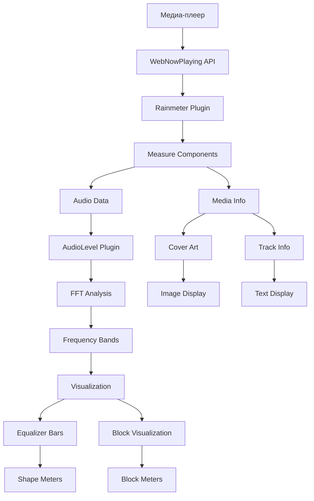

# SquarePlayer - Медиа-плеер для Windows 11

## Описание проекта

**SquarePlayer** — это элегантный виджет медиа-плеера для Windows 11, созданный с использованием Rainmeter. Плеер предоставляет современный интерфейс для управления воспроизведением музыки с поддержкой различных медиа-плееров через WebNowPlaying API.

### Основные возможности:
- 🎵 Управление воспроизведением (Play/Pause, Next/Previous)
- 🎨 Современный дизайн в стиле Windows 11 с эффектом размытия
- 📊 Визуализация аудио с помощью эквалайзера
- 🎯 Поддержка различных медиа-плееров
- ⚙️ Настраиваемые темы и цвета
- 📱 Адаптивное масштабирование

## Структура проекта

```
SquarePlayer-main/
├── @Resources/                    # Ресурсы проекта
│   ├── Blocks.inc                # Блоки для визуализации эквалайзера
│   ├── Default.png               # Изображение по умолчанию
│   ├── MeasureBands.inc          # Измерения для 25-полосного эквалайзера
│   ├── MeasureBandsM.inc         # Измерения для 20-полосного эквалайзера
│   ├── MeasureBandsS.inc         # Измерения для 10-полосного эквалайзера
│   ├── MeterBands.inc            # Визуализация эквалайзера
│   ├── next.png                  # Иконка "Следующий трек"
│   ├── pause.png                 # Иконка "Пауза"
│   ├── play.png                  # Иконка "Воспроизведение"
│   ├── previous.png              # Иконка "Предыдущий трек"
│   ├── repeat.png                # Иконка "Повтор"
│   ├── repeatOne.png             # Иконка "Повтор одного трека"
│   └── shuffle.png               # Иконка "Перемешивание"
├── SquarePlayerS1.ini            # Компактная версия плеера
├── SquarePlayerS2.ini            # Версия с эквалайзером (средняя)
├── SquarePlayerS3.ini            # Горизонтальная версия
├── SquarePlayerS4.ini            # Минималистичная версия
└── SquarePlayerS5.ini            # Версия с блочной визуализацией
```

## Описание файлов

### Основные конфигурационные файлы

#### SquarePlayerS1.ini
- **Назначение**: Компактная квадратная версия плеера
- **Размеры**: 260×260 пикселей (с масштабированием)
- **Особенности**:
  - Квадратный дизайн с обложкой альбома
  - Элементы управления появляются при наведении
  - Полоса прогресса внизу
  - Поддержка темной/светлой темы

#### SquarePlayerS2.ini
- **Назначение**: Версия с эквалайзером
- **Размеры**: 300×510 пикселей
- **Особенности**:
  - 20-полосный эквалайзер
  - Вертикальная компоновка
  - Включен файл `MeasureBandsM.inc`

#### SquarePlayerS3.ini
- **Назначение**: Горизонтальная версия
- **Размеры**: 720×120 пикселей
- **Особенности**:
  - Компактный горизонтальный дизайн
  - 10-полосный эквалайзер
  - Включен файл `MeasureBandsS.inc`

#### SquarePlayerS4.ini
- **Назначение**: Минималистичная версия
- **Размеры**: 475×48 пикселей
- **Особенности**:
  - Очень компактный дизайн
  - Миниатюрная обложка
  - Горизонтальная полоса прогресса

#### SquarePlayerS5.ini
- **Назначение**: Версия с блочной визуализацией
- **Размеры**: 715×120 пикселей
- **Особенности**:
  - Блочная визуализация прогресса
  - 25-полосный эквалайзер
  - Включены файлы `MeasureBands.inc`, `Blocks.inc`, `MeterBands.inc`

### Файлы ресурсов (@Resources/)

#### MeasureBands.inc
- **Назначение**: Конфигурация для 25-полосного эквалайзера
- **Содержит**: 25 измерений аудио-полос (MeasureBand0 - MeasureBand24)
- **Используется в**: SquarePlayerS5.ini

#### MeasureBandsM.inc
- **Назначение**: Конфигурация для 20-полосного эквалайзера
- **Содержит**: 20 измерений аудио-полос (MeasureBand0 - MeasureBand19)
- **Используется в**: SquarePlayerS2.ini

#### MeasureBandsS.inc
- **Назначение**: Конфигурация для 10-полосного эквалайзера
- **Содержит**: 10 измерений аудио-полос (MeasureBand0 - MeasureBand9)
- **Используется в**: SquarePlayerS3.ini, SquarePlayerS4.ini

#### Blocks.inc
- **Назначение**: Логика для блочной визуализации эквалайзера
- **Содержит**: 250 блоков (10 уровней × 25 полос) с условной логикой
- **Используется в**: SquarePlayerS5.ini

#### MeterBands.inc
- **Назначение**: Визуализация блочного эквалайзера
- **Содержит**: 250 прямоугольных форм для отображения блоков
- **Используется в**: SquarePlayerS5.ini

## Архитектура проекта

### Общая структура

Проект построен на основе Rainmeter — системы для создания виджетов рабочего стола Windows. Архитектура следует принципам:

1. **Модульность**: Каждый компонент (эквалайзер, управление, отображение) вынесен в отдельные файлы
2. **Конфигурируемость**: Все параметры вынесены в переменные
3. **Масштабируемость**: Поддержка различных размеров экрана через переменную Scale
4. **Темизация**: Поддержка светлых и темных тем

### Потоки данных



### Компоненты системы

#### 1. WebNowPlaying Plugin
- **Назначение**: Получение данных от медиа-плееров
- **Функции**: Статус воспроизведения, метаданные, управление
- **Поддерживаемые плееры**: Spotify, YouTube Music, VLC, и др.

#### 2. AudioLevel Plugin
- **Назначение**: Анализ аудио-сигнала
- **Функции**: FFT-анализ, разбиение на частотные полосы
- **Параметры**: FFT Size (2048), Attack/Decay, Sensitivity

#### 3. FrostedGlass Plugin
- **Назначение**: Эффект размытия фона
- **Функции**: Acrylic эффект, поддержка тем
- **Параметры**: FrostLevel, Theme, CornerType

#### 4. Measure Components
- **MeasureStatus**: Статус воспроизведения
- **MeasureCover**: Обложка альбома
- **MeasureTitle/Artist**: Метаданные трека
- **MeasureProgress**: Прогресс воспроизведения
- **MeasureBand0-24**: Частотные полосы

#### 5. Meter Components
- **MeterCanvas**: Основной контейнер
- **MeterCover**: Отображение обложки
- **MeterPlayPause**: Кнопка воспроизведения
- **MeterProgress**: Полоса прогресса
- **MeterBands**: Визуализация эквалайзера

## Библиотеки/фреймворки

### Rainmeter
- **Версия**: 4.5+
- **Назначение**: Основная платформа для создания виджетов
- **Особенности**: Поддержка плагинов, скриптов, тем

### WebNowPlaying Plugin
- **Версия**: 1.0.0+
- **Назначение**: Интеграция с медиа-плеерами
- **Поддерживаемые плееры**: Spotify, YouTube Music, VLC, Winamp, и др.

### AudioLevel Plugin
- **Версия**: 1.0.0+
- **Назначение**: Анализ аудио-сигнала
- **Возможности**: FFT-анализ, визуализация, настройка чувствительности

### FrostedGlass Plugin
- **Версия**: 1.0.0+
- **Назначение**: Эффекты размытия и прозрачности
- **Особенности**: Поддержка Windows 11 Acrylic эффекта

## Точка входа и запуск

### Установка

1. **Скачать Rainmeter**:
   - Перейти на [rainmeter.net](https://www.rainmeter.net/)
   - Скачать последнюю версию для Windows 11
   - Установить с правами администратора

2. **Установить плагины**:
   - WebNowPlaying Plugin
   - AudioLevel Plugin
   - FrostedGlass Plugin

3. **Установить SquarePlayer**:
   - Скачать проект с GitHub
   - Распаковать в папку `Documents\Rainmeter\Skins\`
   - Перезапустить Rainmeter

### Запуск

1. Открыть Rainmeter Manager
2. Найти папку "SquarePlayer" в списке скинов
3. Выбрать нужную версию (S1-S5)
4. Дважды кликнуть для загрузки

### Настройка

Основные параметры настройки находятся в секции `[Variables]`:

```ini
[Variables]
Scale = 1.5                    # Масштаб (1.0 = 100%, 1.5 = 150%)
Color = 240,240,240           # Основной цвет (R,G,B)
SubColor = 199,199,199        # Вторичный цвет
Highlight = 254,105,105       # Цвет акцента
FrostLevel = Acrylic          # Уровень размытия
Theme = Dark                  # Тема (Dark/Light1-5)
CornerType = Round            # Тип углов
PlayerId = "Active"           # ID плеера
```

## Архитектурные особенности

### 1. Модульная архитектура
- **Причина**: Упрощение поддержки и расширения
- **Преимущества**: Легко добавлять новые версии, изменять компоненты

### 2. Система масштабирования
- **Причина**: Поддержка различных разрешений экрана
- **Реализация**: Единая переменная Scale для всех размеров

### 3. Условная логика визуализации
- **Причина**: Динамическое отображение элементов
- **Пример**: Блоки эквалайзера появляются при достижении пороговых значений

### 4. Группировка элементов
- **Причина**: Управление видимостью компонентов
- **Группы**: Active (активные элементы), Hover (при наведении)

### 5. Система тем
- **Причина**: Адаптация к системным настройкам Windows
- **Поддержка**: Темная/светлая тема, настраиваемые цвета

## Системные требования

- **ОС**: Windows 11 (рекомендуется) или Windows 10
- **Rainmeter**: версия 4.5 или выше
- **Плагины**: WebNowPlaying, AudioLevel, FrostedGlass
- **Медиа-плеер**: Spotify, YouTube Music, VLC, или другой поддерживаемый плеер

## Поддерживаемые медиа-плееры

- Spotify
- YouTube Music
- VLC Media Player
- Winamp
- AIMP
- MusicBee
- Foobar2000
- И другие с поддержкой WebNowPlaying

---

Автор: legenda  
Telegram: [@LEGENDA_SD](https://t.me/LEGENDA_SD)
